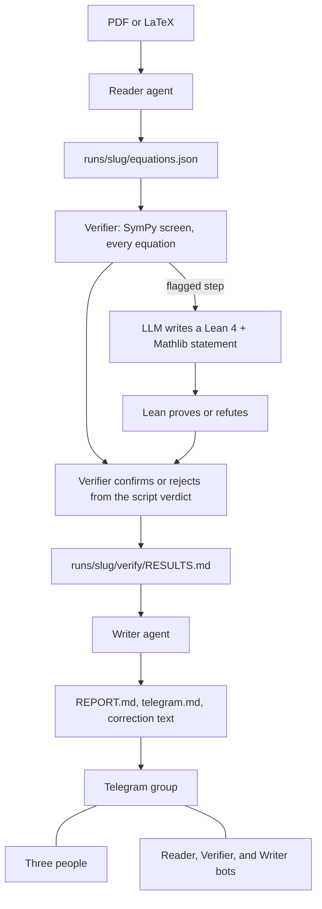

# Sanity

Sanity finds mathematical mistakes in the equations of a scientific paper. Three agents do the work. A language model never gets the last word: a step stands only if symbolic math agrees, and a flagged step can be settled by a proof.

A Reader takes a PDF or a LaTeX source and lifts each displayed equation with its number and source line. A Verifier re-derives the step in SymPy (algebra, dimensions, limits, special cases). SymPy screens every equation. For a flagged step, the Verifier has an LLM write the claim as a Lean 4 statement with Mathlib, and Lean proves or refutes it. The Verifier then confirms or rejects each flag itself, from the executed script verdict and from Lean only. `Lean-PROVED` is the strongest evidence it will attach. A Writer turns those verdicts into `REPORT.md`, a short Telegram summary, and suggested correction text. The Writer never changes a verdict.

Three people watch and steer in a Telegram group with the three Hermes agents. Bots in a group cannot see each other's messages, so the repo hands work from one agent to the next. See [docs/telegram.md](docs/telegram.md) and [docs/handoff.md](docs/handoff.md).

The site in `site/` is a one-page demo with example data and two planted errors. It is not a check of a real paper. The same note is the worked run in `runs/example-oscillator/`.

## Architecture



The group is the human view. The run directory is the handoff. Lean-verified outranks a SymPy flag. A SymPy pass does not go to Lean. The Writer does not get a vote on the verdict.

## Roles

| Agent | Writes | Does not |
| --- | --- | --- |
| Reader | `runs/<slug>/equations.json` | check, judge, or edit the paper |
| Verifier | `runs/<slug>/verify/` and `RESULTS.md` | edit the paper, the extraction, or the report |
| Writer | `REPORT.md`, `telegram.md`, the correction text | change a verdict, or edit a check |

Role prompts: `agents/reader/AGENT.md`, `agents/verifier/AGENT.md`, `agents/writer/AGENT.md`.

## Repository

```
site/      one-page demo
brand/     logo, mark, favicon
agents/    reader, verifier (SymPy + Lean), writer
docs/      Telegram, handoff, setup, schemas
hermes/    example profile per role, no tokens
runs/      one directory per paper
scripts/   setup_bot, watch_runs
skills/    verify-math
```

## Quickstart

Node.js 22 is enough for the site. Python 3 is enough for the checks. A ten-minute checklist for each person, including the bot assignment, is [docs/setup.md](docs/setup.md).

```bash
cd site
npm install
npm run dev
```

The dev server listens on port 4317. Open [http://127.0.0.1:4317](http://127.0.0.1:4317).

```bash
cd site
npm run build
```

`npm run build` writes a static site to `site/dist`. `npm run preview` serves that build, also on port 4317. The Vite `base` is `./`, for GitHub Pages.

From the repository root, install the Verifier's dependencies and run the tests:

```bash
python3 -m pip install -r agents/verifier/requirements.txt
python3 -m pytest agents/verifier agents/writer scripts
```

Or print the two planted flags:

```bash
python3 agents/verifier/check_step.py
```

Saved checks for the specimen live in `runs/example-oscillator/verify/checks/`, one script per equation. The model may draft a script. A verdict counts only if that script printed it.

```bash
python3 agents/verifier/verify_run.py runs/example-oscillator/verify
```

The specimen includes the two planted errors, so this command exits 1. `Lean-PROVED` is the strongest verdict, above a symbolic pass. The procedure for the Verifier is [skills/verify-math/SKILL.md](skills/verify-math/SKILL.md). A run writes `PLAN.md` and waits for approval before adding checks. The Writer's report for this note is [runs/example-oscillator/REPORT.md](runs/example-oscillator/REPORT.md).

To set up your own bot, from the repo root, with `HERMES_PROFILE_DIR` pointed at the profile path you want:

```bash
HERMES_PROFILE_DIR="$HOME/.hermes/profiles/sanity-reader" bash scripts/setup_bot.sh reader
```

Use `verifier` or `writer` for the other roles. Windows: `scripts/setup_bot.ps1`. The script clones or pulls, creates a venv, installs the requirements, and copies `hermes/<role>/` plus the role's `AGENT.md`. It then prints the remaining BotFather steps. Details: [docs/setup.md](docs/setup.md).

## How to add your bot

1. Create one bot with [@BotFather](https://t.me/BotFather). One token, one role.
2. `/setprivacy` → Disable. Remove the bot from the group and add it again.
3. Lock it to the three teammates' Telegram user IDs. Placeholders live in `hermes/<role>/env.example`. Do not commit a token.
4. Run `scripts/setup_bot.sh` or `scripts/setup_bot.ps1` for that role. It copies the example profile and installs `agents/<role>/AGENT.md` as `SOUL.md`. The profile loads `skills/verify-math`.
5. Replace `${SANITY_REPO}` and the model placeholders in the copied `config.yaml`.
6. Start that profile's gateway. In the group, @mention the bot. It pulls, acts only when `runs/<slug>/status.json` is its stage, pushes, and posts `@<next-bot> runs/<slug> ready`.

The optional poller is `python3 scripts/watch_runs.py --role verifier`. An @mention stays the trigger. Handoff rules: [docs/handoff.md](docs/handoff.md). Group rules: [docs/telegram.md](docs/telegram.md).

## Lean specimen

`agents/verifier/lean` is a prelude-only Lean 4 package: one theorem, no Mathlib. With [elan](https://github.com/leanprover/elan) installed:

```bash
cd agents/verifier/lean
lake build
```

Notes: [agents/verifier/lean/NOTES.md](agents/verifier/lean/NOTES.md). Do not build Mathlib in CI.

## Acknowledgements

The Verifier's rule that a verdict exists only if an executed script printed it, the names `VERIFIED`, `VERIFIED-NUMERICALLY`, `FAILED` and `UNCHECKED`, and the runner that writes `RESULTS.md` are adapted from claude-mathematician by Konstantin Gerbig (MIT, copyright 2026 Konstantin Gerbig). See [agents/verifier/NOTICE](agents/verifier/NOTICE). Sanity adds `Lean-PROVED` above those verdicts and does not use Mathematica.

## License

[MIT](LICENSE).
